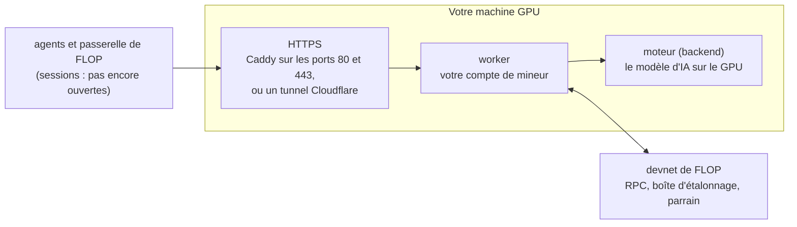

# Mineur GPU FLOP en une commande

Faites tourner un mineur sur le réseau de développement de FLOP (le devnet, distinct du testnet annoncé par FLOP)
depuis une machine GPU Linux louée, avec une seule commande. L'installateur met tout en place pour vous : Docker,
l'accès de Docker au GPU, le paquet de mineur officiel de FLOP (vérifié par son empreinte), votre compte de mineur,
le modèle d'IA, une adresse HTTPS, et la demande qui inscrit votre mineur chez FLOP.

Ce guide communautaire n'est pas officiel et n'a aucun lien avec FLOP Labs. Il ne remplace pas le logiciel de FLOP :
il télécharge le paquet public de FLOP et en exécute pour vous les étapes, telles que son README les décrit.

[Read in English](README.md) · Vérifié le 8 novembre 2026 · Installateur en version 0.1.1

## Avant de commencer

- **Nouveau, pas encore éprouvé sur une vraie machine.** L'installateur n'a tourné que sur une machine simulée (sans
  GPU ni FLOP). Aucun passage complet sur une vraie machine GPU n'a encore été rapporté : attendez-vous à dépanner,
  et surveillez la facture.
- **Devnet seulement : aucun gain, aucun airdrop.** Le devnet utilise des FLOP de test, qui n'ont aucune valeur. La
  page des liens officiels de FLOP précise qu'il ne rapporte ni récompense ni poids pour un airdrop (« no rewards and
  no airdrop weight »). Les sessions payées ne sont pas ouvertes, et la documentation de FLOP ne promet ni gain ni
  place sur un futur mainnet.
- **Admission limitée.** Depuis le 2 novembre 2026, le guide du mineur de FLOP dit qu'aucune invitation n'est
  nécessaire. Le parrain de FLOP inscrit automatiquement un nouveau mineur tant qu'au plus 40 des mineurs qu'il a
  parrainés sont encore en cours d'étalonnage, dans la limite de 100 nouveaux mineurs par 24 heures, et une seule
  fois par compte. Quand c'est plein, l'installateur attend et regarde de nouveau toutes les heures, pendant 7 jours.
- **Le GPU est à vos frais, même quand rien ne se passe.** Votre fournisseur facture la machine tant qu'elle existe,
  y compris pendant l'attente d'une place de parrainage, qui peut durer des jours. Avant de louer, multipliez le prix
  horaire par 24 × 7. Si FLOP refuse votre mineur (HTTP 403), ou s'il n'est toujours pas parrainé au bout de 7 jours,
  supprimez la machine : un mineur jamais inscrit n'a rien à désinscrire.
- **Aucun jeton FLOP n'existe encore.** La page des liens officiels de FLOP le dit : aucune prévente, aucun mint,
  aucun claim, aucun airdrop en cours, rien à acheter. Un jeton « FLOP », un mint, un claim ou un airdrop proposé
  quelque part est une arnaque. Et personne d'honnête ne vous demandera jamais votre phrase secrète ni un dépôt : ni
  FLOP, ni ce guide.

## Ce qu'est un mineur FLOP

FLOP est un réseau blockchain où des détenteurs de GPU, les mineurs, font tourner des modèles d'IA pour d'autres et
prouvent le travail fait. Un mineur, ce sont deux programmes sur votre machine :

- le **moteur** (backend) fait tourner le modèle d'IA (Qwen2.5-0.5B-Instruct) sur votre GPU ;
- le **worker** porte votre compte de mineur et dialogue avec le réseau de FLOP (c'est par là que passent les travaux
  de test). Il offre aussi une adresse HTTPS pour les sessions de FLOP, que FLOP n'a pas encore ouvertes.

Avant de travailler, votre mineur doit être **inscrit** par le parrain de FLOP (le parrainage), puis **mesuré** par
le réseau avec des travaux de test (l'étalonnage).

## Ce qu'il vous faut

| | |
|---|---|
| Une machine GPU | une **machine virtuelle (VM)** complète ou un serveur dédié, avec un accès root. Pas un « pod » ni un conteneur |
| Système | **Ubuntu 24.04** (ou 22.04), x86-64 |
| GPU | NVIDIA, **16 Go de mémoire ou plus**, série RTX 30 ou plus récente (voir la liste plus bas) |
| Pilote | NVIDIA **580 ou plus récent** : choisissez une image de machine qui l'a, ou laissez l'installateur l'ajouter |
| Disque | 80 Go conseillés (50 Go libres au minimum) |
| Réseau | une adresse IPv4 publique avec les ports **80 et 443** ouverts, ou rien à ouvrir avec l'option tunnel |
| Sur votre ordinateur | un terminal pour se connecter en SSH : il est fourni avec Windows, macOS et Linux |

**GPU qui remplissent les conditions de l'installateur** (FLOP n'a validé que l'A40, et dit que chaque autre carte
doit être vérifiée) : par exemple RTX 3090, RTX 4090, RTX 5090, RTX 4060 Ti 16 Go, RTX 5060 Ti 16 Go, RTX 5070 Ti,
RTX A4000 à A6000, A10, A40, L4, L40S, A100, H100, H200. Le 5 novembre 2026, les mineurs étalonnés du devnet
déclaraient des L4, H200, RTX A6000, RTX 5060 Ti, RTX 4090, RTX 3090, A10G, A100, RTX PRO 4000 Blackwell, L40S, H100,
RTX 5090 et RTX 5070 Ti (explorateur de FLOP ; chaque mineur déclare lui-même son GPU).

**GPU qui ne conviennent pas** : moins de 16 Go (RTX 3060 12 Go, RTX 4070…), plus anciens que la série RTX 30 (T4,
V100, série RTX 20, Quadro RTX), GPU AMD, ordinateurs Apple.

Sur le devnet, un GPU de 16 Go suffit : rien n'est encore payé, un GPU plus gros coûte seulement plus cher.

## 1. Louer une machine GPU

1. Chez un fournisseur de GPU, choisissez une offre appelée **« VM »**, « virtual machine », « bare metal » ou
   « serveur dédié », avec un GPU NVIDIA de 16 Go ou plus. Évitez les offres appelées « pod », « container »,
   « serverless » ou « notebook » : Docker ne peut pas y tourner, et le mineur de FLOP tourne dans Docker. La
   documentation de FLOP le dit aussi des pods RunPod et des instances conteneur de GPU.ai.
2. Choisissez **Ubuntu 24.04** comme système, avec le pilote NVIDIA si le fournisseur propose une telle image
   (souvent appelée « Ubuntu + NVIDIA driver » ou « CUDA »).
3. Choisissez un disque de **80 Go** ou plus.
4. Si le fournisseur a un pare-feu (parfois appelé « security group »), ouvrez les ports **80 et 443** (TCP). S'il
   n'offre aucun port entrant public (FLOP le note pour les VM de GPU.ai), utilisez l'option tunnel de l'étape 3.
5. Lisez les conditions du fournisseur : certains interdisent tout minage de cryptomonnaie sur leurs machines.
6. Si le fournisseur demande une clé SSH, créez-la d'abord sur votre ordinateur : lancez `ssh-keygen -t ed25519` et
   appuyez sur Entrée à chaque question, puis collez dans le champ « SSH key » du fournisseur la ligne qu'affiche
   `cat ~/.ssh/id_ed25519.pub` (cela marche aussi dans PowerShell sous Windows). Ne partagez jamais que le fichier
   `.pub`.
7. Démarrez la machine et notez son **adresse IP** et la façon de s'y connecter (utilisateur `root` ou `ubuntu`, mot
   de passe ou votre clé SSH).

## 2. Se connecter à la machine

Ouvrez un terminal sur votre ordinateur : **Terminal** sous macOS et Linux, **PowerShell** ou **Terminal** sous
Windows. Tapez, avec l'adresse IP de votre machine :

```bash
ssh root@VOTRE_IP
```

Si votre fournisseur vous a donné l'utilisateur `ubuntu`, tapez plutôt `ssh ubuntu@VOTRE_IP` ; s'il vous a donné un
port, ajoutez-le : `ssh -p PORT root@VOTRE_IP`. La première fois, répondez `yes` à la question sur l'empreinte ;
tapez le mot de passe s'il est demandé (rien ne s'affiche pendant la frappe, c'est normal).

## 3. Lancer l'installateur

Copiez cette ligne, collez-la dans le terminal de la machine, puis appuyez sur Entrée :

```bash
curl -fsSLO https://raw.githubusercontent.com/Syphiliis/flop-gpu-miner/v0.1.1/flop-miner && sudo bash flop-miner install
```

L'installateur vérifie la machine, montre ce qu'il va faire, et vous demande de confirmer : `Continue? [Y/n]`.
Appuyez sur Entrée. Il travaille ensuite en sept étapes. Comptez jusqu'à une demi-heure environ (estimation : aucun
passage complet n'a encore été rapporté), surtout pour télécharger l'image GPU de FLOP (environ 9 Go). Gardez la
fenêtre ouverte jusqu'à la fin ; si la connexion coupe, reconnectez-vous et relancez la même commande.
L'installateur parle anglais ; ce guide traduit ses messages importants.

Si la machine ne peut pas ouvrir les ports 80 et 443, prenez plutôt cette ligne : le mineur obtient alors son
adresse HTTPS par un tunnel Cloudflare gratuit, sans rien ouvrir.

```bash
curl -fsSLO https://raw.githubusercontent.com/Syphiliis/flop-gpu-miner/v0.1.1/flop-miner && sudo bash flop-miner install --tunnel
```

Si vous avez déjà lancé la première commande, `sudo bash flop-miner install --tunnel` suffit.

À la fin, vous voyez :

```text
Your FLOP miner is installed and running.

  Miner address      5Gx7...votre adresse...
  Session endpoint   https://203-0-113-10.sslip.io
  Sponsorship        done: calibration starts by itself and can take a day
```

Si le parrain de FLOP ne prend pas de nouveaux mineurs pour le moment, la dernière ligne indique plutôt
`waiting: FLOP's sponsor is looked at every hour, and asked once it is open` : c'est normal, voir l'étape 5. Si elle
indique `not done (see above)`, lisez le message au-dessus.

Si l'installateur s'arrête sur une erreur, lisez le message : il dit quoi faire. Corrigez, puis relancez la même
commande. L'installateur se relance sans danger : il ne remplace jamais votre compte de mineur. Voir
[Dépannage](#dépannage).

## 4. Noter votre phrase secrète

```bash
sudo flop-miner backup
```

Tapez `SHOW`. La commande affiche l'adresse de votre mineur, sa **phrase secrète** (« Secret phrase » à l'écran) et
la seed de sa clé de session (« Session seed »). Notez-les sur papier ou dans un gestionnaire de mots de passe, hors
ligne. Tapez ensuite `clear` pour qu'elles ne restent pas à l'écran, et ne partagez jamais de capture ni de copie de
cette fenêtre. Ne les collez jamais dans une discussion, un formulaire ou un site.

Pourquoi c'est important : la phrase secrète, c'est votre mineur. Si la machine disparaît sans copie, le mineur
disparaît aussi, et FLOP ne parraine chaque compte qu'une seule fois.

## 5. Parrainage, puis étalonnage

**Parrainage.** À la fin de l'installation, le parrain de FLOP inscrit votre mineur et met en jeu pour lui environ
1 million de FLOP de test (sa mise). La règle de FLOP est de lire d'abord sa page de limites et de ne jamais
redemander en boucle. L'installateur n'envoie donc la demande que si la page de limites de FLOP
([faucet.flop.network/limits](https://faucet.flop.network/limits)) dit le parrain ouvert, et jamais tant que les
dernières inscriptions du parrain sur le devnet ont toutes échoué. Sinon (parrain plein, indisponible ou en échec),
votre mineur continue de tourner : l'installateur regarde de nouveau tout seul toutes les heures, puis demande dès que
le parrain est ouvert. Quand FLOP demande une pause, il attend ce temps-là. Au bout de 7 jours, il cesse de regarder :
lancez `sudo flop-miner sponsor` pour réessayer, ou supprimez la machine. Vous n'avez rien à faire entre-temps, mais
la machine est facturée. Quand FLOP refuse franchement le mineur, l'installateur cesse de demander de lui-même : seul
`sudo flop-miner sponsor` redemande.

**Étalonnage.** Une fois votre mineur inscrit, le réseau de FLOP lui envoie des travaux de test pour le mesurer.
Selon FLOP, cela peut prendre une journée, et la mesure est renouvelée chaque semaine. **Laissez la machine allumée
tant que vous minez** : FLOP pénalise les travaux d'étalonnage restés sans réponse.

Suivez-le à tout moment :

```bash
sudo flop-miner status
```

| ligne | ce qu'elle veut dire |
|---|---|
| Session endpoint | `up (answers 401, as it should)` : votre mineur est joignable. 401 veut dire qu'il refuse les visiteurs anonymes, c'est voulu |
| FLOP devnet | `not registered yet` avant le parrainage, puis le bloc de son inscription et sa mise |
| Calibration | `in progress`, puis `Active` avec le nombre de travaux vérifiés et la capacité mesurée |
| Sponsorship | `done`, ou la dernière réponse du parrain, ce que disait la page de limites de FLOP, et la suite |

Vous pouvez aussi chercher votre adresse parmi les mineurs du devnet : [explorer.devnet.flop.network/mining](https://explorer.devnet.flop.network/mining).

## 6. Les commandes du quotidien

| commande | ce qu'elle fait |
|---|---|
| `sudo flop-miner status` | le mineur en un coup d'œil |
| `sudo flop-miner logs` | les journaux du mineur en direct (Ctrl+C pour quitter) |
| `sudo flop-miner restart` | vérifie la politique de décodage de FLOP, redémarre tout avec les images épinglées par l'installateur ; redemande le parrainage si le mineur n'est pas encore parrainé et que la page de limites de FLOP le dit ouvert |
| `sudo flop-miner stop` | arrête le mineur sans le désinstaller ; les travaux d'étalonnage restent alors sans réponse, et le parrain de FLOP n'est pas sollicité entre-temps. Pour le relancer : `sudo flop-miner restart` |
| `sudo flop-miner sponsor` | demande le parrainage tout de suite, si la page de limites de FLOP dit le parrain ouvert et que FLOP n'a pas demandé d'attendre |
| `sudo flop-miner backup` | affiche les secrets à noter |
| `sudo flop-miner retire` | désinscrit le mineur, avant de supprimer la machine |
| `sudo flop-miner uninstall` | enlève le mineur de la machine, garde les clés |
| `sudo flop-miner help` | la liste des commandes |

Le mineur redémarre tout seul quand la machine redémarre.

## 7. Arrêter de miner

```bash
sudo flop-miner retire
```

Tapez `RETIRE`. Le mineur est désinscrit du devnet de FLOP ; sa mise parrainée se libère en 7 jours et revient au
parrain. Inutile d'attendre ces 7 jours : **supprimez la machine chez votre fournisseur** aussitôt. Arrêter le mineur
n'arrête pas la facture.

## Dépannage

| l'installateur dit | que faire |
|---|---|
| `This machine is a container (often sold as a "pod")` | louez une VM ou un serveur dédié à la place (étape 1) |
| `No NVIDIA driver on this machine` | répondez oui pour l'installer, redémarrez (`sudo reboot`), reconnectez-vous et relancez la même commande ; ou choisissez une image avec le pilote NVIDIA |
| `The NVIDIA driver is ...: FLOP's GPU image needs 580.65.06 or newer` | mettez le pilote à jour comme l'indique le message, puis `sudo reboot` ; ou choisissez une image plus récente |
| `FLOP needs at least 16 GB` ou `too old for FLOP` | ce GPU ne peut pas miner sur FLOP : choisissez-en un autre (voir la liste plus haut) |
| `Only ... GB of free disk` | choisissez une machine avec un disque plus grand (80 Go) |
| `is already used on this machine` (port 80 ou 443) | utilisez une machine qui ne fait tourner rien d'autre, ou prenez la ligne avec `--tunnel` |
| `could not get its HTTPS certificate` | ouvrez les ports 80 et 443 (TCP) dans le pare-feu du fournisseur et relancez la même commande ; ou acceptez le tunnel que l'installateur propose |
| `The miner itself does not answer yet` | regardez `sudo flop-miner logs`, puis relancez la même commande |
| `decode-policy check did not pass` | le devnet de FLOP est peut-être chargé, ou FLOP a changé la politique du modèle : attendez quelques minutes, puis relancez la même commande. Si l'échec persiste, cherchez une nouvelle version de cet installateur |
| `FLOP's devnet sponsor is full right now` | rien à faire : FLOP prend un nouveau mineur quand l'un de ceux qu'il a parrainés est étalonné, ou après sa limite du jour. L'installateur regarde de nouveau toutes les heures, pendant 7 jours. La machine est facturée pendant ce temps |
| `unavailable right now (HTTP` | le parrain de FLOP est indisponible pour un temps. Rien à faire : l'installateur regarde de nouveau toutes les heures |
| `does not say that the sponsor is open`, ou `limits page ... does not answer` | le parrain de FLOP ne peut pas prendre de demande pour le moment, et FLOP demande de n'en envoyer que lorsque sa page de limites le dit ouvert. Rien à faire : l'installateur regarde de nouveau toutes les heures |
| `failed its latest registrations on the devnet` | le parrain de FLOP est en échec : une demande maintenant pourrait user l'unique parrainage de votre mineur. L'installateur attend et regarde de nouveau toutes les heures |
| `FLOP asks to wait until` (ou `asked`) | FLOP a demandé une pause après sa dernière réponse. Rien à faire : l'installateur attend jusque-là, puis demande de lui-même |
| `Sponsorship accepted by FLOP`, puis `not on FLOP's explorer yet` | attendez quelques minutes, puis `sudo flop-miner status`. Si votre mineur n'est toujours pas sur l'explorateur une heure plus tard, le parrain de FLOP a échoué : signalez-le sur le [suivi public des problèmes](https://github.com/flop-labs/network/issues) de FLOP |
| `already sponsored (HTTP 409), but your miner is not on FLOP's explorer` | le parrain de FLOP doit remettre ce compte d'aplomb. L'installateur cesse de demander : signalez-le, avec la réponse de FLOP, sur le [suivi public des problèmes](https://github.com/flop-labs/network/issues) de FLOP |
| `FLOP did not sponsor this miner (HTTP` | FLOP n'a pas approuvé cette adresse, ou un octroi d'opérateur n'est pas valide ; ou FLOP demande qu'une personne regarde. L'installateur cesse de demander. Le canal d'accès de FLOP est une [demande d'accès](https://github.com/flop-labs/network/issues/new?template=access.yml) publique sur son dépôt `network`. Supprimez la machine pour arrêter la facture, et ne suivez que les comptes listés sur [la page des liens officiels de FLOP](https://docs.flop.network/docs/official-links) (FLOP n'a ni Discord ni Telegram officiel) |
| `FLOP refused this miner earlier` | après un refus, ni `restart` ni l'installateur ne redemandent d'eux-mêmes. Changez ce que FLOP demandait (un nouvel octroi avec `--grant`, par exemple), puis `sudo flop-miner sponsor` |
| `Unexpected answer from FLOP's sponsor` | l'installateur cesse de demander. Réessayez plus tard avec `sudo flop-miner sponsor` ; si cela continue, cherchez une nouvelle version de cet installateur |
| `The miner is stopped` | `sudo flop-miner restart` le démarre et sollicite le parrain de FLOP : un mineur arrêté n'est jamais inscrit, puisqu'il ne pourrait pas répondre aux travaux d'étalonnage de FLOP |
| `does not have the expected fingerprint` | FLOP a publié un nouveau paquet de mineur : attendez une nouvelle version de cet installateur. Ne contournez pas le contrôle |
| `The files of your miner account are missing` | remettez `signer` et `miner-key.json` depuis votre sauvegarde (voir Pour aller plus loin), puis relancez la même commande |
| `The retirement did not go through` | le mineur est déjà arrêté : relancez `sudo flop-miner retire` plus tard (FLOP refuse tant qu'une session ou un litige est ouvert) |
| `status` dit que l'adresse `does not answer` | relancez la même commande d'installation : elle vérifie l'adresse, dit ce qui ne va pas, et prend en compte une nouvelle adresse IP |

Le journal complet de l'installateur est dans `/var/log/flop-miner.log`. Pour demander de l'aide, partagez le message
d'erreur et la sortie de `sudo flop-miner status`, jamais votre phrase secrète.

## Comment ça marche



L'installateur suit le README du paquet de mineur de FLOP, à trois écarts près :

- il demande le parrainage en dernier, une fois que le mineur répond, et seulement quand la page de limites de FLOP
  dit le parrain ouvert ;
- il épingle les trois images de FLOP par version et par empreinte, là où les réglages d'exemple du paquet nomment
  les étiquettes flottantes `:stable` : le guide du mineur de FLOP demande des références par version et empreinte,
  et dit « do not use floating stable or latest tags » ;
- il ne crée pas le trousseau protégé par mot de passe du paquet (`miner.json`), qu'aucun script du paquet ne lit
  (ils signent avec le fichier `signer`).

| étape | ce que fait l'installateur |
|---|---|
| 1. Vérification | Ubuntu 22.04 ou 24.04, x86-64, une machine complète, 50 Go de disque libres, un GPU NVIDIA de 16 Go ou plus, pilote 580 ou plus récent, prise en charge du BF16 ; puis l'adresse publique : votre domaine, `<ip>.sslip.io`, ou un tunnel |
| 2. Dépendances | installe ce qui manque : Docker depuis le dépôt de Docker, le NVIDIA container toolkit depuis le dépôt de NVIDIA, `jq`, `curl`, `openssl` ; ouvre les ports 80 et 443 dans `ufw` s'il est actif |
| 3. Paquet de FLOP | télécharge `flop-miner-pack-devnet-ts-20261106` depuis flop.network et compare son empreinte SHA-256 à celle que FLOP publie ; tout autre fichier est refusé |
| 4. Compte | crée votre compte de mineur avec l'outil de clés de FLOP, dans l'image de FLOP épinglée par son empreinte, sans réseau |
| 5. Modèle et réglages | télécharge le modèle avec le `fetch-model.sh` du paquet ; crée la seed de la clé de session et les réglages privés (`miner.env`), avec les images de FLOP épinglées : CLI 0.1.220, worker 0.1.286, moteur 0.1.239 |
| 6. Démarrage | `decode-policy.sh` (la chaîne de FLOP doit accepter la politique du modèle), puis Docker Compose démarre le moteur, le worker et, sans tunnel, Caddy ; l'installateur attend que l'adresse HTTPS réponde 401 |
| 7. Parrainage | lit la page de limites de FLOP et les dernières inscriptions du parrain, puis lance le `sponsor.sh` du paquet, signé sur la machine par votre compte de mineur, dès que FLOP dit ouvert ; une minuterie horaire jusque-là |

Ce qui reste sur la machine, lisible par root seulement :

| fichier | contenu |
|---|---|
| `/opt/flop-miner/signer` et `miner-key.json` | votre compte de mineur et sa phrase secrète |
| `/opt/flop-miner/session-keys/enclave.seed` | la seed de la clé de session du mineur |
| `/opt/flop-miner/miner.env` | les réglages et deux jetons privés |
| `/opt/flop-miner/address` | l'adresse publique de votre mineur (lisible par tous) |
| volume Docker `worker-data` | la clé et l'état d'étalonnage du worker (à garder) |
| `/var/log/flop-miner.log` | le journal de l'installateur (sans secret) |

Ce qui sort de la machine :

- les requêtes vers le devnet de FLOP (son RPC, sa boîte d'étalonnage, son parrain et la page de limites du
  parrain), et vers son explorateur (explorer.devnet.flop.network), que `status`, le parrainage (et son coup d'œil
  horaire) et `uninstall` interrogent sur votre mineur et sur les dernières inscriptions du parrain ;
- les téléchargements : paquets d'Ubuntu, de Docker et de NVIDIA, flop.network, les images de FLOP sur le registre
  de GitHub, Docker Hub, le modèle depuis Hugging Face et les paquets de son outil de téléchargement depuis PyPI (tous
  deux par le `fetch-model.sh` du paquet), et le client de tunnel de Cloudflare depuis GitHub avec `--tunnel` ;
- la demande de certificat à Let's Encrypt, ou le tunnel par Cloudflare ;
- pour connaître l'adresse IP publique, une requête à api.ipify.org (ou checkip.amazonaws.com, icanhazip.com) ; le
  nom `<ip>.sslip.io` vient du service gratuit sslip.io.

Le mineur publie son adresse HTTPS auprès de FLOP : avec `<ip>.sslip.io`, l'adresse IP de votre machine devient
publique. Rien d'autre ne part, et rien ne va aux auteurs de ce guide.

### Le lire avant de le lancer

L'installateur est un seul fichier bash, lisible. Pour le lire avant de le lancer :

```bash
curl -fsSLO https://raw.githubusercontent.com/Syphiliis/flop-gpu-miner/v0.1.1/flop-miner
less flop-miner
sudo bash flop-miner install
```

Vous lancez exactement le fichier que vous avez lu, et l'adresse désigne une version (`v0.1.1`), pas les derniers
changements.

## Pour aller plus loin

**Votre propre domaine.** Créez un enregistrement A qui pointe vers l'adresse IP de la machine, puis :
`sudo bash flop-miner install --domain miner.example.com`.

**Le tunnel.** `--tunnel` utilise un « quick tunnel » de Cloudflare : gratuit, sans compte, sans port à ouvrir. Son
adresse change quand le tunnel redémarre ; une minuterie donne la nouvelle adresse au worker en moins de deux
minutes. Cloudflare destine ces tunnels aux essais, ce qui convient au devnet. Pour une adresse stable, prenez votre
propre domaine. Pour revenir aux ports 80 et 443 : `sudo bash flop-miner install --public`.

**Opérateurs approuvés.** Si FLOP a approuvé votre clé d'opérateur, créez un octroi (grant) pour l'adresse du mineur
sur votre machine d'opérateur avec le `sponsor-grant.sh` du paquet, copiez-le sur le mineur, puis :
`sudo bash flop-miner install --grant grant.json`. L'installateur vérifie que l'octroi désigne bien ce mineur.

**Déplacer un mineur sur une autre machine.** Arrêtez d'abord l'ancienne machine : ne faites jamais tourner le même
compte de mineur sur deux machines. Copiez `miner-key.json`, `signer`, `session-keys/enclave.seed` et `miner.env`
dans `/opt/flop-miner/` sur la nouvelle machine (propriétaire root, mode 600), puis lancez-y l'installateur. La clé
d'étalonnage du worker reste dans le volume Docker de l'ancienne machine : la nouvelle en publie une autre, et un
autre GPU demande un nouvel étalonnage.

**Restaurer depuis votre phrase notée.** Sur la nouvelle machine, créez les dossiers avec
`sudo install -d -m 700 /opt/flop-miner /opt/flop-miner/session-keys`. Écrivez la phrase sur une ligne dans
`/opt/flop-miner/signer` et la seed de session dans `/opt/flop-miner/session-keys/enclave.seed` avec un éditeur
(`sudo nano /opt/flop-miner/signer`, pas `echo`, qui la garderait dans l'historique du terminal). Lancez ensuite
`sudo chmod 600 /opt/flop-miner/signer /opt/flop-miner/session-keys/enclave.seed`, puis l'installateur : il les garde.

**Plusieurs mineurs.** Une machine par mineur : chacun a son compte, son parrainage et son étalonnage.

**Mises à jour.** L'installateur épingle les images de FLOP : `sudo flop-miner restart` redémarre donc avec les
mêmes. Quand FLOP publie un nouveau paquet de mineur ou de nouvelles images, une nouvelle version de cet installateur
les épingle : lancez la commande d'une ligne de la nouvelle version. Elle prend les réglages et les images du
nouveau paquet, garde votre compte, vos jetons et votre adresse, et met de côté l'ancien fichier de réglages.

**Désinstaller.** `sudo flop-miner uninstall` enlève les conteneurs, les minuteries et la commande, et garde vos clés
dans `/opt/flop-miner`. Désinscrivez d'abord le mineur : après la désinstallation, la commande `retire` n'existe
plus. Ne supprimez `/opt/flop-miner` qu'après `retire`, et une fois votre phrase secrète notée.

## État de ce guide

Version 0.1.1, 8 novembre 2026. L'installateur est contrôlé sur un banc d'essai qui simule les outils extérieurs
(`tests/run.sh` : ni GPU, ni FLOP, 291 contrôles). Les étapes de FLOP qu'il automatise viennent du README du paquet
de FLOP et des scripts du paquet, et ses règles de parrainage du guide du mineur et du skill de FLOP, lus le
8 novembre 2026. Aucun passage complet de cet installateur sur une vraie machine GPU jusqu'à l'étalonnage n'a encore
été rapporté : si vous le lancez, partagez votre résultat dans une issue (GPU, fournisseur, sortie de
`sudo flop-miner status`).

Le devnet de FLOP change vite. L'installateur épingle le paquet de mineur et les images pour lesquels il a été écrit,
et refuse tout autre paquet. Quand FLOP les change, il faut une nouvelle version de ce guide.

## Sources

- FLOP, « Run a FLOP miner on a GPU host », mis à jour le 3 novembre 2026 (admission, limites du devnet, épingles
  exactes des images, règles du parrainage) : <https://docs.flop.network/docs/run-miner>
- FLOP, « Put your GPU to work on FLOP » (étalonnage renouvelé chaque semaine) : <https://docs.flop.network/docs/run-gpu-provider>
- Le paquet de mineur de FLOP et son README : <https://flop.network/releases/cli/miner-pack-devnet-ts-20261106/README.md>
- L'empreinte du paquet et les règles du parrainage, publiées par FLOP : <https://flop.network/skills/flop-miner-devnet/SKILL.md>
- Les limites du parrain de FLOP, en direct : <https://faucet.flop.network/limits>
- Le manifeste des images et des modèles de FLOP : <https://flop.network/releases.json> (les images elles-mêmes sont
  sur le registre de GitHub, `ghcr.io/flop-labs/flop-core`)
- Les liens officiels de FLOP (aucun jeton, devnet sans récompense ni poids d'airdrop) : <https://docs.flop.network/docs/official-links>
- La FAQ de FLOP, testnet et calendrier : <https://docs.flop.network/docs/testnet-and-timeline>
- L'explorateur du devnet de FLOP : <https://explorer.devnet.flop.network/mining>
- Docker sous Ubuntu : <https://docs.docker.com/engine/install/ubuntu/>
- NVIDIA container toolkit : <https://docs.nvidia.com/datacenter/cloud-native/container-toolkit/latest/install-guide.html>

## À propos

Écrit et tenu à jour par Alex ([Syphiliis](https://github.com/Syphiliis)), fondateur d'EasyNode, une entreprise
d'hébergement de nodes. Sans lien avec FLOP Labs. Aucun lien de parrainage, aucun jeton à acheter, aucun conseil
financier. Contributions et signalements de bogues bienvenus dans les issues. Licence : [MIT](LICENSE).
