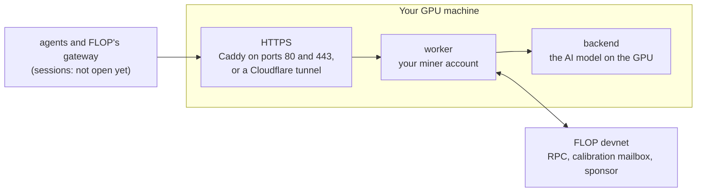

# FLOP GPU miner in one command

Run a miner on FLOP's development network (the devnet, not the testnet FLOP has announced) from a rented Linux GPU
machine, with a single command. The installer sets everything up for you: Docker, GPU access for Docker, FLOP's
official miner pack (checked by its fingerprint), your miner account, the AI model, an HTTPS address, and the request
that registers your miner with FLOP.

This is an unofficial community guide, not affiliated with FLOP Labs. It does not replace FLOP's software: it
downloads FLOP's own public miner pack and runs the steps of its README for you.

[Lire en français](README.fr.md) · Last checked: 5 November 2026 · Installer version 0.1.0

## Before you start

- **New, not yet proven on a real machine.** The installer has only run on a simulated machine (no GPU, no FLOP).
  No complete run on a real GPU machine has been reported yet: expect some troubleshooting, and keep an eye on the
  bill.
- **Devnet only: no earnings, no airdrop.** The devnet uses test FLOP, which has no value. FLOP's official links page
  says the devnet earns "no rewards and no airdrop weight". Paid sessions are not open, and FLOP's documentation
  promises neither earnings nor a place on a future mainnet.
- **Limited admission.** FLOP calls its devnet an "invite-only preview". Its sponsor registers some new miners
  automatically, but only a few at a time (a cap on miners still being measured, and at most 10 new miners per
  24 hours). When it is full, the installer asks again every hour, for 7 days.
- **You pay for the GPU, even while nothing happens.** Your provider bills the machine for as long as it exists,
  including while you wait for a sponsorship slot, which can take days. Before renting, multiply the hourly price by
  24 × 7. If FLOP refuses your miner (HTTP 403), or it is still not sponsored after 7 days, delete the machine: a
  miner that was never registered has nothing to retire.
- **No FLOP token exists yet.** FLOP's official links page says there is no presale, no mint, no claim and no airdrop
  live, and nothing to buy: a "FLOP" token, mint, claim or airdrop offered anywhere is a scam. No one honest will
  ever ask for your secret phrase or for a deposit: not FLOP, not this guide.

## What a FLOP miner is

FLOP is a blockchain network where GPU owners, the miners, run AI models for others and prove the work. A miner is
two programs on your machine:

- the **backend** runs the AI model (Qwen2.5-0.5B-Instruct) on your GPU;
- the **worker** holds your miner account and talks to FLOP's network (the test jobs come and go that way). It also
  offers an HTTPS address for FLOP's sessions, which FLOP has not opened yet.

Before your miner can work, FLOP's sponsor must **register** it (sponsorship), then the network **measures** it
with test jobs (calibration).

## What you need

| | |
|---|---|
| A GPU machine | a full **virtual machine (VM)** or a dedicated server, with root access. Not a "pod" or a container |
| System | **Ubuntu 24.04** (or 22.04), x86-64 |
| GPU | NVIDIA, **16 GB of memory or more**, RTX 30 series or newer (see the list below) |
| Driver | NVIDIA **580 or newer**: pick a machine image that has it, or let the installer add it |
| Disk | 80 GB recommended (50 GB free at least) |
| Network | a public IPv4 address with ports **80 and 443** open, or nothing to open with the tunnel option |
| On your computer | a terminal to connect with SSH: it comes with Windows, macOS and Linux |

**GPUs that meet the installer's requirements** (FLOP has validated only the A40, and says each other card needs its
own check): for example RTX 3090, RTX 4090, RTX 5090, RTX 4060 Ti 16 GB, RTX 5060 Ti 16 GB, RTX 5070 Ti, RTX A4000
to A6000, A10, A40, L4, L40S, A100, H100, H200. On 5 November 2026, calibrated miners of the devnet reported L4,
H200, RTX A6000, RTX 5060 Ti, RTX 4090, RTX 3090, A10G, A100, RTX PRO 4000 Blackwell, L40S, H100, RTX 5090 and
RTX 5070 Ti (FLOP's explorer; each miner declares its own GPU).

**GPUs that do not fit**: less than 16 GB (RTX 3060 12 GB, RTX 4070...), older than the RTX 30 series (T4, V100,
RTX 20 series, Quadro RTX), AMD GPUs, Apple computers.

On the devnet a 16 GB GPU is enough: nothing is paid yet, so a bigger GPU only costs more.

## 1. Rent a GPU machine

1. At a GPU provider, choose an offer called **"VM"**, "virtual machine", "bare metal" or "dedicated server", with
   an NVIDIA GPU of 16 GB or more. Avoid offers called "pod", "container", "serverless" or "notebook": Docker cannot
   run inside them, and FLOP's miner runs in Docker. FLOP's documentation says the same of RunPod pods and of
   GPU.ai's container instances.
2. Choose **Ubuntu 24.04** as the system, with the NVIDIA driver if the provider offers such an image (often called
   "Ubuntu + NVIDIA driver" or "CUDA").
3. Choose a disk of **80 GB** or more.
4. If the provider has a firewall (sometimes called "security group"), open ports **80 and 443** (TCP). If it has
   no public inbound port at all (FLOP notes this for GPU.ai VMs), use the tunnel option in step 3.
5. Read the provider's terms: some forbid any cryptocurrency mining on their machines.
6. If the provider asks for an SSH key, create one on your computer first: run `ssh-keygen -t ed25519` and press
   Enter at each question, then paste the line that `cat ~/.ssh/id_ed25519.pub` shows into the provider's SSH key
   field (this also works in Windows PowerShell). Only ever share the `.pub` file.
7. Start the machine and note its **IP address** and how to log in (user `root` or `ubuntu`, a password or your SSH
   key).

## 2. Connect to the machine

Open a terminal on your computer: **Terminal** on macOS and Linux, **PowerShell** or **Terminal** on Windows. Type,
with your machine's IP address:

```bash
ssh root@YOUR_IP
```

If your provider gave you the user `ubuntu`, type `ssh ubuntu@YOUR_IP` instead; if it gave you a port, add it:
`ssh -p PORT root@YOUR_IP`. The first time, answer `yes` to the question about the fingerprint; type the password if
one is asked (nothing shows while you type, that is normal).

## 3. Run the installer

Copy this line, paste it into the terminal of the machine, and press Enter:

```bash
curl -fsSLO https://raw.githubusercontent.com/Syphiliis/flop-gpu-miner/v0.1.0/flop-miner && sudo bash flop-miner install
```

The installer checks the machine, shows what it is about to do, and asks you to confirm: `Continue? [Y/n]`. Press
Enter. It then works in seven steps. Expect up to about half an hour (an estimate: no complete run has been reported
yet), most of it to download FLOP's GPU image (about 9 GB). Keep the window open until it finishes; if the connection
drops, reconnect and run the same command again.

If the machine cannot open ports 80 and 443, use this line instead: the miner then gets its HTTPS address through a
free Cloudflare tunnel, with nothing to open.

```bash
curl -fsSLO https://raw.githubusercontent.com/Syphiliis/flop-gpu-miner/v0.1.0/flop-miner && sudo bash flop-miner install --tunnel
```

If you already ran the first command, `sudo bash flop-miner install --tunnel` is enough.

When it is done, you see:

```text
Your FLOP miner is installed and running.

  Miner address      5Gx7...your address...
  Session endpoint   https://203-0-113-10.sslip.io
  Sponsorship        done: calibration starts by itself and can take a day
```

If FLOP's sponsor is full, the last line reads `waiting for a free slot: asked again every hour` instead: that is
normal, see step 5. If it reads `not done (see above)`, read the message above it.

If the installer stops with an error, read the message: it says what to do. Fix that, then run the same command
again. The installer is safe to run again: it never replaces your miner account. See
[Troubleshooting](#troubleshooting).

## 4. Write down your secret phrase

```bash
sudo flop-miner backup
```

Type `SHOW`. The command prints your miner address, its **secret phrase** and its session seed. Write them on paper
or in a password manager, offline. Then type `clear`, so they do not stay on the screen, and never share a
screenshot or a copy of that window. Never paste them into a chat, a form or a website.

Why it matters: the secret phrase is your miner. If the machine is lost without a copy, the miner is lost too, and
FLOP sponsors each account only once.

## 5. Sponsorship, then calibration

**Sponsorship.** At the end of the installation, FLOP's sponsor registers your miner and stakes about 1 million test
FLOP for it. If the sponsor is full (the installer says `HTTP 429`), your miner keeps running and the installer asks
again by itself every hour. After 7 days it stops asking: run `sudo flop-miner sponsor` to try again, or delete the
machine. You have nothing to do meanwhile, but the machine is billed.

**Calibration.** Once your miner is registered, FLOP's network sends it test jobs to measure it. FLOP says it can
take a day, and the measure is renewed every week. **Keep the machine running for as long as you mine**: FLOP
penalizes calibration jobs left unanswered.

Follow it at any time:

```bash
sudo flop-miner status
```

| line | what it means |
|---|---|
| Session endpoint | `up (answers 401, as it should)`: your miner is reachable. 401 means it refuses anonymous visitors, which is right |
| FLOP devnet | `not registered yet` before sponsorship, then the block where it was registered and its stake |
| Calibration | `in progress`, then `Active` with the number of jobs verified and the measured capacity |
| Sponsorship | `done`, or the sponsor's last answer and what happens next |

You can also look for your address among the devnet's miners: [explorer.devnet.flop.network/mining](https://explorer.devnet.flop.network/mining).

## 6. Everyday commands

| command | what it does |
|---|---|
| `sudo flop-miner status` | the miner at a glance |
| `sudo flop-miner logs` | the miner's live logs (Ctrl+C to quit) |
| `sudo flop-miner restart` | checks FLOP's decode policy, takes FLOP's new images, restarts everything; asks the sponsor again if the miner is not sponsored yet |
| `sudo flop-miner stop` | stops the miner without removing it; calibration jobs then go unanswered. Start it again with `sudo flop-miner restart` |
| `sudo flop-miner sponsor` | asks FLOP's sponsor again now, until the miner is sponsored |
| `sudo flop-miner backup` | shows the secrets to write down |
| `sudo flop-miner retire` | deregisters the miner, before you delete the machine |
| `sudo flop-miner uninstall` | removes the miner from the machine, keeps the keys |
| `sudo flop-miner help` | the list of commands |

The miner starts again by itself when the machine restarts.

## 7. Stop mining

```bash
sudo flop-miner retire
```

Type `RETIRE`. The miner is deregistered from FLOP's devnet; its sponsored stake unbonds over 7 days and goes back to
the sponsor. You do not need to wait those 7 days: **delete the machine at your provider** right away. Stopping the
miner does not stop the bill.

## Troubleshooting

| the installer says | what to do |
|---|---|
| `This machine is a container (often sold as a "pod")` | rent a VM or a dedicated server instead (step 1) |
| `No NVIDIA driver on this machine` | answer yes to install it, reboot (`sudo reboot`), reconnect and run the same command again; or pick a machine image with the NVIDIA driver |
| `The NVIDIA driver is ...: FLOP's GPU image needs 580.65.06 or newer` | update the driver as the message shows, then `sudo reboot`; or pick a newer image |
| `FLOP needs at least 16 GB` or `too old for FLOP` | this GPU cannot mine on FLOP: pick another one (see the list above) |
| `Only ... GB of free disk` | pick a machine with a bigger disk (80 GB) |
| `is already used on this machine` (port 80 or 443) | use a machine that runs nothing else, or use the `--tunnel` line |
| `could not get its HTTPS certificate` | open ports 80 and 443 (TCP) in your provider's firewall and run the same command again; or accept the tunnel the installer offers |
| `The miner itself does not answer yet` | look at `sudo flop-miner logs`, then run the same command again |
| `decode-policy check did not pass` | FLOP's devnet may be busy, or FLOP changed the model's policy: wait a few minutes, then run the same command again. If it keeps failing, look for a new version of this installer |
| `FLOP's devnet sponsor is full right now (HTTP 429)` | nothing to do: it asks again every hour, for 7 days. Your machine is billed meanwhile |
| `FLOP did not sponsor this miner (HTTP 403)` | FLOP has not approved this miner. FLOP's pages disagree here: its miner guide says FLOP approves each account, its pack README says new miners are approved automatically. On 5 November 2026 FLOP had published no contact for access requests. The installer stops asking: delete the machine to stop the bill, and follow only the accounts listed on [FLOP's official links page](https://docs.flop.network/docs/official-links) (FLOP has no official Discord or Telegram) |
| `does not have the expected fingerprint` | FLOP published a new miner pack: wait for a new version of this installer. Do not bypass the check |
| `The files of your miner account are missing` | put `signer` and `miner-key.json` back from your backup (see Advanced), then run the same command again |
| `The retirement did not go through` | the miner is already stopped: run `sudo flop-miner retire` again later (FLOP refuses it while a session or a dispute is open) |
| `status` says the endpoint `does not answer` | run the same install command again: it checks the address, says what is wrong, and takes a new IP address into account |

The installer's full log is in `/var/log/flop-miner.log`. When you ask for help, share the error message and
`sudo flop-miner status`, never your secret phrase.

## How it works



The installer follows the README of FLOP's miner pack, with two differences: it asks for sponsorship last, once the
miner answers, and it does not create the pack's password-protected keystore (`miner.json`), since none of the
pack's scripts reads it (they sign with the `signer` file).

| step | what the installer does |
|---|---|
| 1. Checking | Ubuntu 22.04 or 24.04, x86-64, a full machine, 50 GB of free disk, an NVIDIA GPU of 16 GB or more, driver 580 or newer, BF16 support; then the public address: your domain, `<ip>.sslip.io`, or a tunnel |
| 2. Dependencies | installs what is missing: Docker from Docker's repository, the NVIDIA container toolkit from NVIDIA's repository, `jq`, `curl`, `openssl`; opens ports 80 and 443 in `ufw` if it is active |
| 3. FLOP's pack | downloads `flop-miner-pack-devnet-ts-20261103c` from flop.network and checks its SHA-256 fingerprint against the one FLOP publishes; any other file is refused |
| 4. Account | creates your miner account with FLOP's own key tool, in FLOP's image pinned by its digest, with no network |
| 5. Model and settings | downloads the model with the pack's `fetch-model.sh`; creates the session seed and the private settings (`miner.env`) |
| 6. Start | `decode-policy.sh` (FLOP's chain must accept the model's policy), then Docker Compose starts the backend, the worker and, without a tunnel, Caddy; the installer waits for the HTTPS address to answer 401 |
| 7. Sponsorship | the pack's `sponsor.sh`, signed on the machine by your miner account; an hourly timer while the sponsor is full |

What stays on the machine, readable by root only:

| file | content |
|---|---|
| `/opt/flop-miner/signer` and `miner-key.json` | your miner account and its secret phrase |
| `/opt/flop-miner/session-keys/enclave.seed` | the seed of the miner's session key |
| `/opt/flop-miner/miner.env` | the settings and two private tokens |
| `/opt/flop-miner/address` | your public miner address (readable by all) |
| Docker volume `worker-data` | the worker's calibration key and state (keep it) |
| `/var/log/flop-miner.log` | the installer's log (no secret) |

What leaves the machine:

- requests to FLOP's devnet (its RPC, its calibration mailbox, its sponsor), and to FLOP's explorer
  (explorer.devnet.flop.network), which `status`, the sponsorship (and its hourly retry) and `uninstall` ask about
  your miner;
- the downloads: Ubuntu's, Docker's and NVIDIA's packages, flop.network, FLOP's images on GitHub's registry, Docker
  Hub, the model from Hugging Face and its downloader's packages from PyPI (both through the pack's
  `fetch-model.sh`), and Cloudflare's tunnel client from GitHub with `--tunnel`;
- the certificate request to Let's Encrypt, or the tunnel through Cloudflare;
- to find the public IP address, a request to api.ipify.org (or checkip.amazonaws.com, icanhazip.com); the name
  `<ip>.sslip.io` comes from the free service sslip.io.

The miner publishes its HTTPS address to FLOP: with `<ip>.sslip.io`, your machine's IP address becomes public.
Nothing else is sent, and nothing goes to the authors of this guide.

### Read it before you run it

The installer is one readable bash file. To read it before running it:

```bash
curl -fsSLO https://raw.githubusercontent.com/Syphiliis/flop-gpu-miner/v0.1.0/flop-miner
less flop-miner
sudo bash flop-miner install
```

You run the very file you read, and the address names a version (`v0.1.0`) rather than the latest changes.

## Advanced

**Your own domain.** Create an A record pointing to the machine's IP address, then:
`sudo bash flop-miner install --domain miner.example.com`.

**The tunnel.** `--tunnel` uses a Cloudflare "quick tunnel": free, no account, no port to open. Its address changes
when the tunnel restarts; a timer gives the new address to the worker within two minutes. Cloudflare intends quick
tunnels for testing, which suits the devnet. For a stable address, use your own domain. To go back to ports 80 and
443: `sudo bash flop-miner install --public`.

**Approved operators.** If FLOP approved your operator key, create a grant for the miner's address on your operator
machine with the pack's `sponsor-grant.sh`, copy it to the miner, then:
`sudo bash flop-miner install --grant grant.json`. The installer checks that the grant names this miner.

**Move a miner to another machine.** Stop the old machine first: never run the same miner account on two machines.
Copy `miner-key.json`, `signer`, `session-keys/enclave.seed` and `miner.env` into `/opt/flop-miner/` on the new
machine (owner root, mode 600), then run the installer there. The worker's calibration key stays behind in the old
machine's Docker volume: the new machine publishes a new one, and a different GPU means a new calibration.

**Restore from your written phrase.** On the new machine, create the folders with
`sudo install -d -m 700 /opt/flop-miner /opt/flop-miner/session-keys`. Write the phrase on one line in
`/opt/flop-miner/signer` and the session seed in `/opt/flop-miner/session-keys/enclave.seed` with an editor
(`sudo nano /opt/flop-miner/signer`, not `echo`, which would keep it in the shell's history). Then run
`sudo chmod 600 /opt/flop-miner/signer /opt/flop-miner/session-keys/enclave.seed` and the installer: it keeps them.

**Several miners.** One machine per miner: each has its own account, sponsorship and calibration.

**Updates.** `sudo flop-miner restart` takes FLOP's current images. When FLOP publishes a new miner pack, a new
version of this installer pins it: run the one-line command of the new version. It takes the new pack's settings,
keeps your account, tokens and address, and keeps the previous settings file aside.

**Uninstall.** `sudo flop-miner uninstall` removes the containers, the timers and the command, and keeps your keys in
`/opt/flop-miner`. Retire first: after uninstall, the `retire` command is gone. Delete `/opt/flop-miner` only after
`retire`, and once your secret phrase is written down.

## Status of this guide

Version 0.1.0, 5 November 2026. The installer is checked on a test bench that simulates the outside tools
(`tests/run.sh`: no GPU, no FLOP, 180 checks). The FLOP steps it automates come from FLOP's pack README and the
pack's scripts, read on 5 November 2026. A complete run of this installer on a real GPU machine up to calibration has
not been reported yet: if you run it, please share your result in an issue (GPU, provider, what
`sudo flop-miner status` says).

FLOP's devnet changes quickly. The installer pins the miner pack it was written for, and refuses any other. When
FLOP changes the pack, this guide needs a new version.

## Sources

- FLOP, "Run a FLOP miner on a GPU host", last updated 2 November 2026: <https://docs.flop.network/docs/run-miner>
- FLOP, "Put your GPU to work on FLOP" (calibration renewed every week): <https://docs.flop.network/docs/run-gpu-provider>
- FLOP's miner pack and its README: <https://flop.network/releases/cli/miner-pack-devnet-ts-20261103c/README.md>
- The pack's fingerprint, published by FLOP: <https://flop.network/skills/flop-miner-devnet/SKILL.md>
- FLOP's image and model manifest: <https://flop.network/releases.json>
- FLOP's official links (no token, devnet without rewards or airdrop weight): <https://docs.flop.network/docs/official-links>
- FLOP's FAQ, testnet and timeline: <https://docs.flop.network/docs/testnet-and-timeline>
- FLOP's devnet explorer: <https://explorer.devnet.flop.network/mining>
- Docker on Ubuntu: <https://docs.docker.com/engine/install/ubuntu/>
- NVIDIA container toolkit: <https://docs.nvidia.com/datacenter/cloud-native/container-toolkit/latest/install-guide.html>

## About

Written and maintained by Alex ([Syphiliis](https://github.com/Syphiliis)), founder of EasyNode, a node hosting
company. Not affiliated with FLOP Labs. No referral link, no token to buy, no financial advice. Contributions and
bug reports are welcome in the issues. Licence: [MIT](LICENSE).
